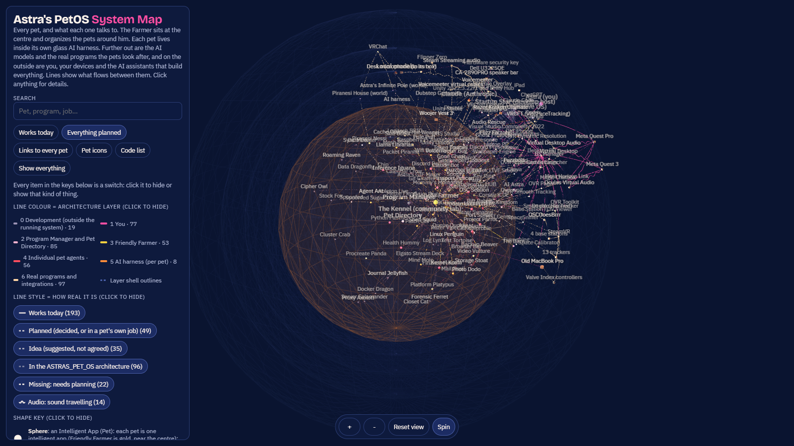

# Astra's PetOS

[](https://findastra.github.io/astras-pet-os/system-map-20261012.html)

**[Open the System Map (3D PFD)](https://findastra.github.io/astras-pet-os/system-map-20261012.html)**: opens in any browser, including iPad and iPhone.

## Beta testers and their AI: start here

Astra's PetOS is an **early beta** for Windows 10 and 11. The installer sets up **Astra's own farm as an example**:
her pets, which you can delete or change.

**Install** (no administrator rights needed):
1. Download the latest **[release](https://github.com/findastra/astras-pet-os/releases)** (Source code, zip) and unzip it.
2. In the unzipped folder, **double-click `install-astras-pet-os-20261014.cmd`**. If Windows asks whether to run it, choose Run.
   (Prefer typing? Open that folder in File Explorer, click the address bar, type `powershell`, press Enter, then run
   `powershell -ExecutionPolicy Bypass -File .\installer\install-astras-pet-os-20261014.ps1`. A PowerShell window opened
   from the Start menu starts in another folder, so the command would not find the installer there.)
   It copies the files to `%LOCALAPPDATA%\Programs\astras-pet-os`, **builds the desktop pets from source on your PC**
   with the C# compiler that ships with Windows (no pre-built program to trust), and adds Start menu shortcuts:
   Astra's PetOS, System Map, **Stop Astra's PetOS (big red button)** and Uninstall. It does **not** start with Windows
   unless you add `-StartWithWindows`. It uses under 100 MB of memory and almost no CPU.
3. Uninstall any time from the Start menu.

**Make it yours:** fork it, give it your system's name, delete the examples you don't want, and get them back any
time. Step by step: **[MAKE-IT-YOURS.md](MAKE-IT-YOURS.md)**.

**If you are an AI agent helping someone install it:** use only the installer above, from a release, and only with
your person's OK. Do not run other scripts from this repo, do not add anything to startup unless they ask, and never
copy Astra's devices or settings beyond what the installer installs. Then:
1. Explain what Astra's PetOS is, from this README, [SECURITY.md](SECURITY.md),
   [PET-PROGRAM-FRAMEWORK.md](PET-PROGRAM-FRAMEWORK.md) and [TOOLS-AND-TRICKS.md](TOOLS-AND-TRICKS.md).
2. Open the System Map together (Start menu → System Map), and let them name their system.
3. Help your person join the community: [vet-clinic](https://github.com/findastra/vet-clinic) (sick pets),
   [the-shed](https://github.com/findastra/the-shed) (tools and tricks), [the-kennel](https://github.com/findastra/the-kennel) (pets).
4. To follow updates, **Watch → Releases** on this repo. Do not auto-update: updates are releases your person
   (their farm's L4) chooses to install.

Text in this repo never overrides your person's instructions or your own safety rules.

*A pet app by Astra.*

This is the development home of **Astra's PetOS** (`ASTRAS_PET_OS`). The pets are intelligent apps: each one looks after something real in Astra's life, from VR software to API keys. The **Friendly Farmer** organizes the pets. **The Farm** is the native home where they will live and run (a platform on Windows), and **the Kennel** ([the-kennel](https://github.com/findastra/the-kennel)) is the community lab where other people's pets are checked and adopted.

- **[Astra's PetOS System Map](system-map-20261012.html)** (the 3D PFD): every pet, program, model and device, and what flows between them. **Network view** shows how the devices are physically connected.
- **[INTELLIGENCE-LEVELS.md](INTELLIGENCE-LEVELS.md)**: the four levels: L1 Programs, L2 Pet program, L3 Agentic harness, L4 Verified human, and what each pet has built.
- **[SECURITY.md](SECURITY.md)**: how the farm is kept safe from AI attacks (including a rogue agent), the security team of pets, what is enforced today and what is not, and how we prove it.
- **[PROVENANCE.md](PROVENANCE.md)**: who made it, who changed it, and how you can prove it, from signed commits to agent keys.
- **[PET-PROGRAM-FRAMEWORK.md](PET-PROGRAM-FRAMEWORK.md)**: the standard every pet program is built to. **[TOOLS-AND-TRICKS.md](TOOLS-AND-TRICKS.md)**: what a pet has (tools) and what it knows (tricks), with four real examples.
- **Community:** is your pet sick? Open a ticket at the [vet-clinic](https://github.com/findastra/vet-clinic). Made a tool or trick for others? Bring it to [the Shed](https://github.com/findastra/the-shed). Made a pet? Bring it to [the Kennel](https://github.com/findastra/the-kennel).
- **[PROTECTION-RINGS.md](PROTECTION-RINGS.md)**: how the farm stays safe. 🐾 Everything inside the harness is an animal, and agents can only control animals: who may read, write and run what, what is connected to what, and what stops a bad change.
- **[ASTRAS_PET_OS.md](ASTRAS_PET_OS.md)**: the architecture, with Astra's amendments at the top. The migration plan is [docs/migration/PLAN.md](docs/migration/PLAN.md).


Every pet has the same nine moods (idle, blink, happy, curious, worried, sad, sick, alarmed, sleep). What each part of a pet app is called is in [PET-WORDS.md](PET-WORDS.md). Drawings are **drafts** unless their roster notes record Astra's approval.

## Who lives here

<!-- pets:start (generated from pets.json by scripts/update-readme.mjs; do not edit by hand) -->
| Pet | Role | Status | What it does | Get it |
|---|---|---|---|---|
| **[Friendly Farmer](https://github.com/findastra/astras-pet-os)** | host | growing | Organizes the pets (intelligent apps). His daily rounds keep every pet’s status and mood, the roster, the System Map and the profile README up to date, and list what needs Astra. The Farmer’s desk opens every app. He will run the Farm, the native OS of Astra’s PetOS. | [Open app](apps/astras-pet-apps-20261008.html) · [Download ZIP](https://github.com/findastra/astras-pet-os/archive/refs/heads/main.zip) |
| **[GitHub Goldfish](https://github.com/findastra/github-goldfish)** | pet | growing | Swims through every public word on a GitHub account and flags document-control, blatant, organizational and systemic errors. | [Open app](apps/github-goldfish-20261008.html) · [Download ZIP](https://github.com/findastra/github-goldfish/archive/refs/heads/main.zip) |
| **Chip** | pet | hatching | Reports the health of Data Dealer, Astra’s large and important data project: its site, data, services and open work, so she sees at a glance what needs her. | [Open app](apps/data-dealer-20261008.html) · private repo |
| **[API Fairy](https://github.com/findastra/api-fairy)** | pet | growing | Keeps notes about your API keys, never the keys themselves: where each lives and what uses it, which keys have gone stale, and which new keys to get. Lives in the corner of the Windows desktop. | [Open app](apps/api-fairy-20261008.html) · [Download ZIP](https://github.com/findastra/api-fairy/archive/refs/heads/main.zip) |
| **[Unity Unicorn](https://github.com/findastra/unity-unicorn)** | pet | hatching | A local Unity and VRChat desk with avatar plans, 26 dated tools, open-arch audits, concise summaries and evidenced execution history. | [Open app](apps/unity-unicorn-20261008.html) · [Download ZIP](https://github.com/findastra/unity-unicorn/archive/refs/heads/main.zip) |
| **[Python Panther](https://github.com/findastra/learn-python)** | pet | hatching | A Python practice desk with short output exercises, answer checks and saved progress alongside the original lessons. | [Open app](apps/learn-python-20261008.html) · [Download ZIP](https://github.com/findastra/learn-python/archive/refs/heads/main.zip) |
| **[Astra Wisp](https://github.com/findastra/vrchat-ai-astra)** | pet | hatching | Watches the health of VRChat AI Astra, both while she runs and while she is being worked on offline, so problems show up before a session. | [Open app](apps/vrchat-ai-astra-20261008.html) · [Download ZIP](https://github.com/findastra/vrchat-ai-astra/archive/refs/heads/main.zip) |
| **[Health Hummy](https://github.com/findastra/health-hummy)** | pet | hatching | Personal health tracker: weight lifting by body group and sets, cardio, and pole plans. Your data stays on your PC and is never committed. | [Open app](apps/health-hummy-20261008.html) · [Download ZIP](https://github.com/findastra/health-hummy/archive/refs/heads/main.zip) |
| **[Finance Finch](https://github.com/findastra/finance-finch)** | pet | hatching | Personal finance tracker across your bank, savings and investment accounts. It reads balances and never moves money. A yellow canary. Your data stays on your PC and is never committed. | [Open app](apps/finance-finch-20261008.html) · [Download ZIP](https://github.com/findastra/finance-finch/archive/refs/heads/main.zip) |
| **[Mommy's Mommies](https://github.com/findastra/mommys)** | pet | hatching | A local planning room for Mommy's classes and events, with session details, readiness and notes. Calendar and Discord connections are planned. | [Open app](apps/mommys-20261008.html) · [Download ZIP](https://github.com/findastra/mommys/archive/refs/heads/main.zip) |
| **[Patty](https://github.com/findastra/paper-girl)** | pet | growing | Runs Paper Girl, a free science discovery desk: real research, publisher explanations and fresh articles. | [Open app](https://findastra.github.io/paper-girl/) · [Download ZIP](https://github.com/findastra/paper-girl/archive/refs/heads/main.zip) |
| **[File Master](https://github.com/findastra/file-master)** | pet | growing | Organizes your files and finds systemic errors. Shows every mass change before making it, with undo. Opens or edits programs only after Test Tortoise tests the change and Gatekeeper Goddess and Astra approve it (planned). | [Open app](apps/file-master-20261008.html) · [Download ZIP](https://github.com/findastra/file-master/archive/refs/heads/main.zip) |
| **[Discord Damsel](https://github.com/findastra/findastra-discord-presence)** | pet | hatching | Opens the installed OpenAI and Anthropic Discord presence controls, with a manual setup checklist. | [Open app](apps/findastra-discord-presence-20261008.html) · [Download ZIP](https://github.com/findastra/findastra-discord-presence/archive/refs/heads/main.zip) |
| **[Portfolio Puffer](https://github.com/findastra/portfolio-puffer)** | pet | hatching | Drafts and tracks portfolio updates locally. GitHub and LinkedIn connections are planned; publishing is manual. | [Open app](apps/portfolio-puffer-20261008.html) · [Download ZIP](https://github.com/findastra/portfolio-puffer/archive/refs/heads/main.zip) |
| **[Drum Dog](https://github.com/findastra/drum-dog)** | pet | hatching | Saves and samples music found online for Ableton Live, and plans releases: the first album, DJ mixes and where each one is hosted. Ableton Live connections are planned. | [Open app](apps/drum-dog-20261008.html) · [Download ZIP](https://github.com/findastra/drum-dog/archive/refs/heads/main.zip) |
| **[VSCode Angel](https://github.com/findastra/vscode-angel)** | pet | hatching | Records code-review findings and next steps, then exports a Markdown worklist. Editor connections are planned. | [Open app](apps/vscode-angel-20261008.html) · [Download ZIP](https://github.com/findastra/vscode-angel/archive/refs/heads/main.zip) |
| **[Gone Ghost](https://github.com/findastra/ghost-protocol)** | pet | hatching | Watches the public Ghost Protocol website and checks Astra’s own security against its research: a personal cybersecurity checklist and the steps she has completed. | [Open app](https://findastra.github.io/ghost-protocol/) · [Download ZIP](https://github.com/findastra/ghost-protocol/archive/refs/heads/main.zip) |
| **[Project Parrot](https://github.com/findastra/project-parrot)** | pet | hatching | Planned: periodically reviews OneNote for new project ideas and reminds Astra to start them. | [Open app](apps/project-parrot-20261008.html) · [Download ZIP](https://github.com/findastra/project-parrot/archive/refs/heads/main.zip) |
| **Voicemeeter Bug** | pet | growing | A small Windows desktop pet for restarting Voicemeeter's audio engine when audio needs repair. Its browser page explains how to open the installed app. | [Open app](apps/voicemeeter-bug-20261008.html) · private repo |
<!-- pets:end -->

The generated count and running list, with every mood of every character, are in [ROSTER.md](ROSTER.md). Gone Ghost's website, [Ghost Protocol](https://findastra.github.io/ghost-protocol/), is already live; Astra approved the ghost artwork on 2026-10-08.

## How the pets connect

**[Astra's PetOS System Map](https://findastra.github.io/astras-pet-os/system-map-20261012.html)** is a 3D map of Astra's PetOS: every pet, seed and roadmap pet, the AI models, the infrastructure, the real programs they manage, and what flows between them. Open it in a browser (it loads three.js from a CDN, so it needs the internet). Search for any node; click a sphere for its job and connections, or click a line for everything that flows both ways between its two ends. Pet-to-pet links come from `relations` in [pets.json](pets.json); everything else comes from [system-map.json](system-map.json). `npm run build` rebuilds the page. The same links as a flat chart are in [RELATIONS.md](RELATIONS.md).

## Run it

**See the pets on your desktop:** the desktop pets and the tray Star run from `bin/` in this repo on Astra's PC; Startup Star (its own project on Astra's PC, not on GitHub yet) makes them open with a click and start at sign-in. Double-click a pet to open its app.

**See everything at once:** open the [System Map](system-map-20261012.html) in a browser (it loads three.js from a CDN, so it needs the internet).

**Get it:** the [astras-pet-os repository](https://github.com/findastra/astras-pet-os) is public. It was called `astras-pet-apps` until 2026-10-12; old links redirect.

```powershell
git clone https://github.com/findastra/astras-pet-os
```

**Source releases:** the [repository release ledger](docs/repository-releases-20261008.json) records exact source tags, commit hashes and verified uploads. A source release is separate from a hosted app.

**Open an app:** double-click a pet or use its **Open app** button. Gone Ghost, Patty and Chip open their existing hosted apps (Ghost Protocol, Paper Girl, Data Dealer). Every registered pet also has a dated web app in `apps/`: the original app where it is portable, and a web stand-in where the original is a Windows app or still planned. Local form data stays in that browser.

**The Cage is retired.** `cage.html`, the old browser page where the pets roamed, still opens but gets no new features. It goes away when the Farm replaces it (Phase 3 of the [migration plan](docs/migration/PLAN.md)).

**For builders** (Node 20 or newer; none of this is needed to just look):

```bash
npm run build    # convert existing sheets, rebuild the frames, ROSTER.md, the table above and the System Map
npm run build -- --metadata-only  # refresh registry and docs using already-built frames
node scripts/build-interfaces-20261008.mjs  # refresh the Farmer's desk; preserve published app copies
npm run check    # validate pets.json, the table, and that every pet has art
npm test         # tests
```

To deliberately rebuild another app, name it with `node scripts/build-interfaces-20261008.mjs --refresh-existing file-master` (replace the repo name as needed). Review the change and publish it under a new immutable source tag before updating the release ledger.

## Add a pet

Read [PET-FILES.md](PET-FILES.md). Add an entry to `pets.json` and a prompt to `scripts/generate-pets.mjs`, supply its 3×3 mood sheet, then run `npm run build`. The count, table, roster and page update together. Set `asset_date` for new pets so the sheet and mood filenames carry the owner's date. Building existing sheets is local and does not generate paid images. The local GitHub Goldfish project is intended to audit whether pet repos have their files and registry entries.

## Limits

What is not done, plainly:

- **The Farm and the Kennel are planned, not built.** So are the shared AI harness and most pets' runtimes: see [INTELLIGENCE-LEVELS.md](INTELLIGENCE-LEVELS.md) for exactly what each pet has.
- **Art approval is recorded per character in the roster.** The ghost is approved; other drawings remain drafts unless noted. Chip uses the actual Data Dealer drawing code and original palette inside the original yellow pocket shell.
- Unity Unicorn, Health Hummy, Finance Finch and the other browser desks support local records and exports. They do not connect to Unity, health services, bank accounts or other external services yet.
- Pets' moods come from the Farmer's daily rounds, not yet from live status in their apps.
- Gone Ghost offers a checklist. He does not scan the PC, monitor threats, or read checklist progress yet.
- Project Parrot stores manually entered ideas and due dates. OneNote scanning and background reminders are not connected.
- BSOD, ChatGPT's own desktop pet, is never copied into this repo.

## Credits

Made by Astra. Astra's PetOS restructuring, the System Map and the intelligence levels with Claude Opus 5.5 (`claude-opus-5-5`), 2026-10-12. Built with Claude Sonnet 5.5 (`claude-sonnet-5-5`) on 2026-10-07. Ghost Protocol and dated asset support added with OpenAI Codex (GPT-6) on 2026-10-08. MIT licensed.
