# Roster

*The running list of everyone who lives in the Cage. Generated from [pets.json](pets.json) by `npm run build`; edit `pets.json`, not this file.*

**20 pet apps so far, drawn as 20 characters (20 app pets, 0 companions, 0 mascots). 20 of the 20 pet apps have a repo on GitHub.**

Whether each of those repos carries its `pet.json` and the `pet-app` topic is not recorded here. Run `npm run check -- --online` to ask GitHub.

Last updated 2026-10-11. Drawings below are **drafts** unless their notes record Astra's approval. The pets are generated pixel art; how they are made is in [PET-FILES.md](PET-FILES.md).

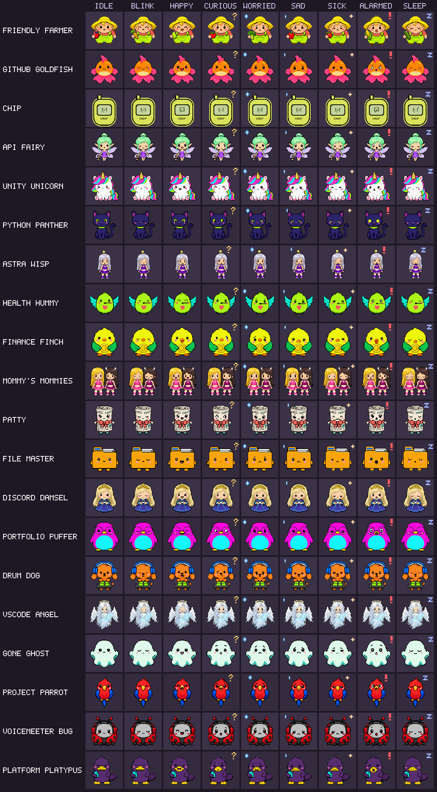

Sheet order: rows are Friendly Farmer, GitHub Goldfish, Chip, API Fairy, Unity Unicorn, Python Panther, Astra Wisp, Health Hummy, Finance Finch, Mommy's Mommies, Patty, File Master, Discord Damsel, Portfolio Puffer, Drum Dog, VSCode Angel, Gone Ghost, Project Parrot, Voicemeeter Bug, Platform Platypus; columns are idle, blink, happy, curious, worried, sad, sick, alarmed, sleep.

## Pet apps

| # | Pet | Role | Status | On GitHub | What it does | Art |
|---|---|---|---|---|---|---|
| 1 | **Friendly Farmer** | host | growing | [astras-pet-os](https://github.com/findastra/astras-pet-os) | Organizes the pets (intelligent apps). His daily rounds keep every pet’s status and mood, the roster, the System Map and the profile README up to date, and list what needs Astra. The Farmer’s desk opens every app. He will run the Farm, the native OS of Astra’s PetOS. | 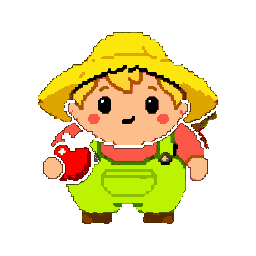 |
| 2 | **GitHub Goldfish** | pet | growing | [github-goldfish](https://github.com/findastra/github-goldfish) | Swims through every public word on a GitHub account and flags document-control, blatant, organizational and systemic errors. | 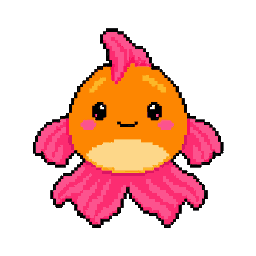 |
| 3 | **Chip** | pet | hatching | private repo | Reports the health of Data Dealer, Astra’s large and important data project: its site, data, services and open work, so she sees at a glance what needs her. | 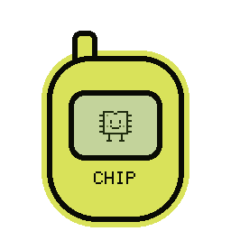 |
| 4 | **API Fairy** | pet | growing | [api-fairy](https://github.com/findastra/api-fairy) | Keeps notes about your API keys, never the keys themselves: where each lives and what uses it, which keys have gone stale, and which new keys to get. Lives in the corner of the Windows desktop. | 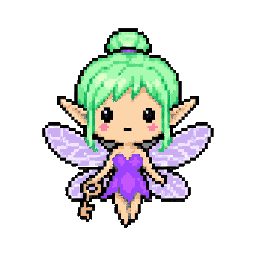 |
| 5 | **Unity Unicorn** | pet | hatching | [unity-unicorn](https://github.com/findastra/unity-unicorn) | A local Unity and VRChat desk with avatar plans, 26 dated tools, open-arch audits, concise summaries and evidenced execution history. | 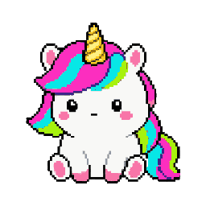 |
| 6 | **Python Panther** | pet | hatching | [learn-python](https://github.com/findastra/learn-python) | A Python practice desk with short output exercises, answer checks and saved progress alongside the original lessons. | 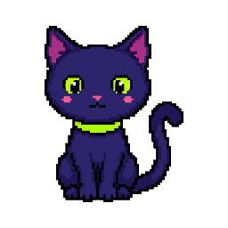 |
| 7 | **Astra Wisp** | pet | hatching | [vrchat-ai-astra](https://github.com/findastra/vrchat-ai-astra) | Watches the health of VRChat AI Astra, both while she runs and while she is being worked on offline, so problems show up before a session. | 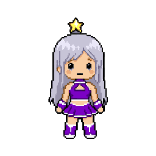 |
| 8 | **Health Hummy** | pet | hatching | [health-hummy](https://github.com/findastra/health-hummy) | Personal health tracker: weight lifting by body group and sets, cardio, and pole plans. Your data stays on your PC and is never committed. | 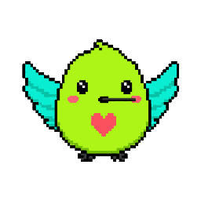 |
| 9 | **Finance Finch** | pet | hatching | [finance-finch](https://github.com/findastra/finance-finch) | Personal finance tracker across your bank, savings and investment accounts. It reads balances and never moves money. A yellow canary. Your data stays on your PC and is never committed. | 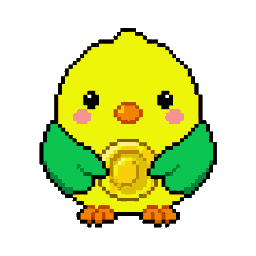 |
| 10 | **Mommy's Mommies** | pet | hatching | [mommys](https://github.com/findastra/mommys) | A local planning room for Mommy's classes and events, with session details, readiness and notes. Calendar and Discord connections are planned. | 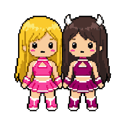 |
| 11 | **Patty** | pet | growing | [paper-girl](https://github.com/findastra/paper-girl) | Runs Paper Girl, a free science discovery desk: real research, publisher explanations and fresh articles. | 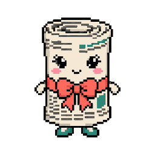 |
| 12 | **File Master** | pet | growing | [file-master](https://github.com/findastra/file-master) | Organizes your files and finds systemic errors. Shows every mass change before making it, with undo. Opens or edits programs only after Test Tortoise tests the change and Gatekeeper Goddess and Astra approve it (planned). | 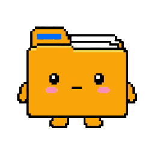 |
| 13 | **Discord Damsel** | pet | hatching | [findastra-discord-presence](https://github.com/findastra/findastra-discord-presence) | Opens the installed OpenAI and Anthropic Discord presence controls, with a manual setup checklist. |  |
| 14 | **Portfolio Puffer** | pet | hatching | [portfolio-puffer](https://github.com/findastra/portfolio-puffer) | Drafts and tracks portfolio updates locally. GitHub and LinkedIn connections are planned; publishing is manual. | 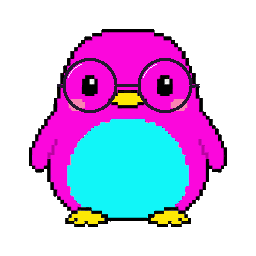 |
| 15 | **Drum Dog** | pet | hatching | [drum-dog](https://github.com/findastra/drum-dog) | Saves and samples music found online for Ableton Live, and plans releases: the first album, DJ mixes and where each one is hosted. Ableton Live connections are planned. | 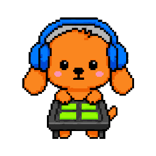 |
| 16 | **VSCode Angel** | pet | hatching | [vscode-angel](https://github.com/findastra/vscode-angel) | Records code-review findings and next steps, then exports a Markdown worklist. Editor connections are planned. | 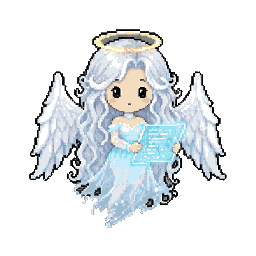 |
| 17 | **Gone Ghost** | pet | hatching | [ghost-protocol](https://github.com/findastra/ghost-protocol) | Watches the public Ghost Protocol website and checks Astra’s own security against its research: a personal cybersecurity checklist and the steps she has completed. | 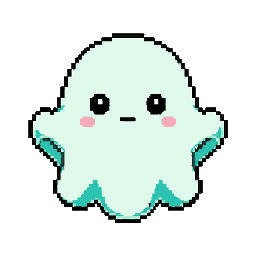 |
| 18 | **Project Parrot** | pet | hatching | [project-parrot](https://github.com/findastra/project-parrot) | Planned: periodically reviews OneNote for new project ideas and reminds Astra to start them. | 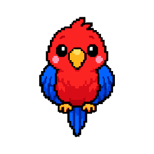 |
| 19 | **Voicemeeter Bug** | pet | growing | private repo | A small Windows desktop pet for restarting Voicemeeter's audio engine when audio needs repair. Its browser page explains how to open the installed app. | 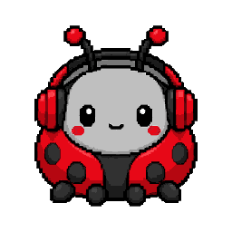 |
| 20 | **Platform Platypus** | pet | hatching | [platform-platypus](https://github.com/findastra/platform-platypus) | Keeps Astra's pages working on iPhone, Android, iPad and desktop: shows a page on every device at once, checks it, tracks what each watched site still needs, and compares screenshots from two platforms. | 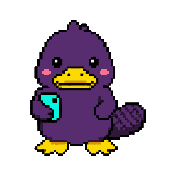 |

## Every mood

### Friendly Farmer

*DRAFT. Repaired faces, visible blond hair and a different fruit or vegetable in each mood, requested by Astra on 2026-10-08. Original lime overalls, coral shirt and straw hat retained.*

| idle | blink | happy | curious | worried | sad | sick | alarmed | sleep |
|:-:|:-:|:-:|:-:|:-:|:-:|:-:|:-:|:-:|
|  | 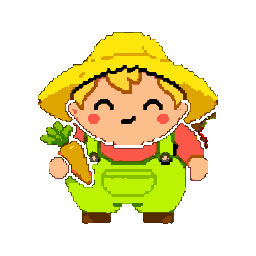 | 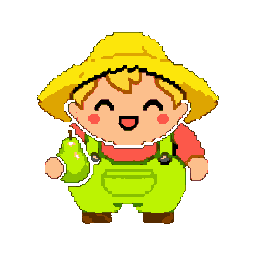 | 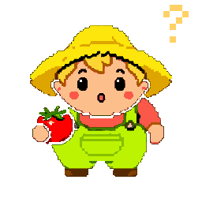 | 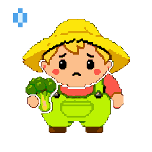 | 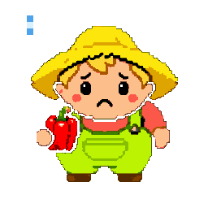 | 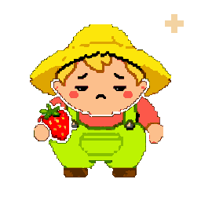 | 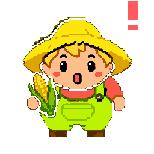 | 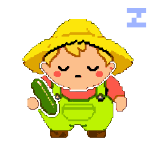 |

### GitHub Goldfish

| idle | blink | happy | curious | worried | sad | sick | alarmed | sleep |
|:-:|:-:|:-:|:-:|:-:|:-:|:-:|:-:|:-:|
|  | 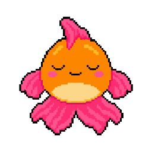 | 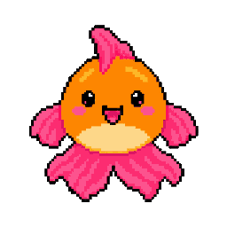 | 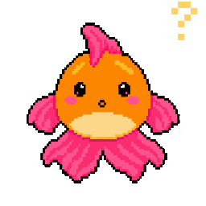 | 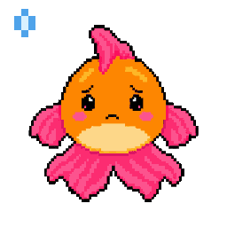 | 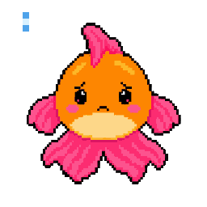 | 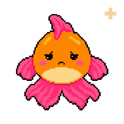 | 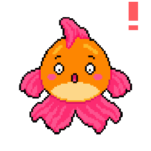 | 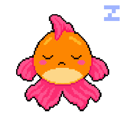 |

### Chip

*Original Data Dealer drawing code, preserved at integer scale inside its yellow pocket launcher. Uses the exact original LCD palette and pixel geometry. The original app repository is private.*

| idle | blink | happy | curious | worried | sad | sick | alarmed | sleep |
|:-:|:-:|:-:|:-:|:-:|:-:|:-:|:-:|:-:|
|  |  |  | 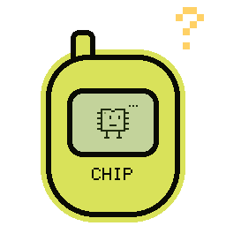 | 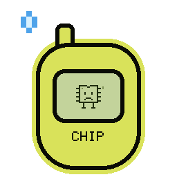 | 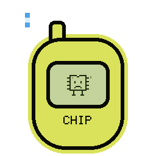 | 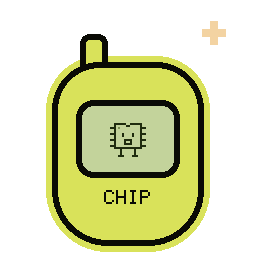 | 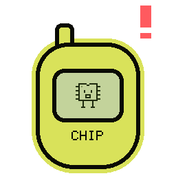 | 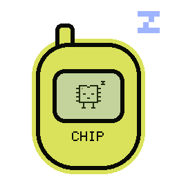 |

### API Fairy

*Redrawn in the Cage style from her 32x24 LCD original (pink hair, mint wings).*

| idle | blink | happy | curious | worried | sad | sick | alarmed | sleep |
|:-:|:-:|:-:|:-:|:-:|:-:|:-:|:-:|:-:|
|  | 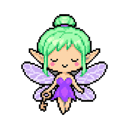 | 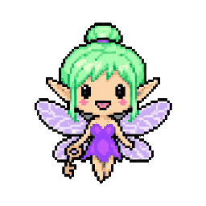 | 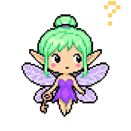 | 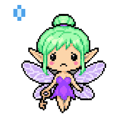 | 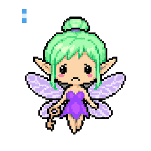 | 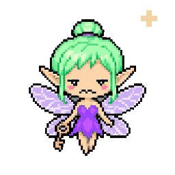 | 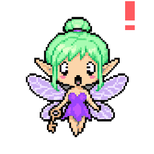 | 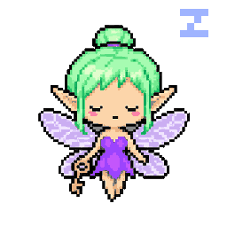 |

### Unity Unicorn

| idle | blink | happy | curious | worried | sad | sick | alarmed | sleep |
|:-:|:-:|:-:|:-:|:-:|:-:|:-:|:-:|:-:|
|  |  |  |  |  |  |  |  |  |

### Python Panther

*A panther, not a snake. Python blue and yellow on dark fur.*

| idle | blink | happy | curious | worried | sad | sick | alarmed | sleep |
|:-:|:-:|:-:|:-:|:-:|:-:|:-:|:-:|:-:|
|  |  |  |  |  |  |  |  |  |

### Astra Wisp

*DRAFT. The name Wisp is a placeholder.*

| idle | blink | happy | curious | worried | sad | sick | alarmed | sleep |
|:-:|:-:|:-:|:-:|:-:|:-:|:-:|:-:|:-:|
|  |  |  |  |  |  |  |  |  |

### Health Hummy

*DRAFT as a hummingbird (a guess from the name).*

| idle | blink | happy | curious | worried | sad | sick | alarmed | sleep |
|:-:|:-:|:-:|:-:|:-:|:-:|:-:|:-:|:-:|
|  |  |  |  |  |  |  |  |  |

### Finance Finch

| idle | blink | happy | curious | worried | sad | sick | alarmed | sleep |
|:-:|:-:|:-:|:-:|:-:|:-:|:-:|:-:|:-:|
|  |  |  |  |  |  |  |  |  |

### Mommy's Mommies

*DRAFT, drawn from the twin mascots on the Mommy's website (blonde hair and green eyes; dark brunette hair, white horns and blue eyes). Their lines come from that page.*

| idle | blink | happy | curious | worried | sad | sick | alarmed | sleep |
|:-:|:-:|:-:|:-:|:-:|:-:|:-:|:-:|:-:|
|  |  |  |  |  |  |  |  |  |

### Patty

*DRAFT. Dark mauve and pink from the site, a folded paper hat, a rolled paper.*

| idle | blink | happy | curious | worried | sad | sick | alarmed | sleep |
|:-:|:-:|:-:|:-:|:-:|:-:|:-:|:-:|:-:|
|  |  |  |  |  |  |  |  |  |

### File Master

*DRAFT as a manila folder.*

| idle | blink | happy | curious | worried | sad | sick | alarmed | sleep |
|:-:|:-:|:-:|:-:|:-:|:-:|:-:|:-:|:-:|
|  |  |  |  |  |  |  |  |  |

### Discord Damsel

*DRAFT. Blurple hennin and veil; no Discord logo.*

| idle | blink | happy | curious | worried | sad | sick | alarmed | sleep |
|:-:|:-:|:-:|:-:|:-:|:-:|:-:|:-:|:-:|
|  |  |  |  |  |  |  |  |  |

### Portfolio Puffer

*DRAFT. A penguin, electric magenta and cyan.*

| idle | blink | happy | curious | worried | sad | sick | alarmed | sleep |
|:-:|:-:|:-:|:-:|:-:|:-:|:-:|:-:|:-:|
|  |  |  |  |  |  |  |  |  |

### Drum Dog

*DRAFT. A local music-project notebook is available. It does not connect to Ableton Live or acquire samples.*

| idle | blink | happy | curious | worried | sad | sick | alarmed | sleep |
|:-:|:-:|:-:|:-:|:-:|:-:|:-:|:-:|:-:|
|  |  |  |  |  |  |  |  |  |

### VSCode Angel

*DRAFT. The job is taken from the session where Astra named it; confirm the scope with her.*

| idle | blink | happy | curious | worried | sad | sick | alarmed | sleep |
|:-:|:-:|:-:|:-:|:-:|:-:|:-:|:-:|:-:|
|  |  |  |  |  |  |  |  |  |

### Gone Ghost

*Art approved by Astra on 2026-10-08. A pale mint ghost with bright teal inner folds. Its checklist is live; the Cage character is not connected to checklist progress or security monitoring.*

| idle | blink | happy | curious | worried | sad | sick | alarmed | sleep |
|:-:|:-:|:-:|:-:|:-:|:-:|:-:|:-:|:-:|
|  |  |  |  |  |  |  |  |  |

### Project Parrot

*DRAFT. Officially named Project Parrot, replacing Project Pal. The local desk stores manually entered ideas and due dates. OneNote scanning and background reminder integration remain unconnected.*

| idle | blink | happy | curious | worried | sad | sick | alarmed | sleep |
|:-:|:-:|:-:|:-:|:-:|:-:|:-:|:-:|:-:|
|  |  |  |  |  |  |  |  |  |

### Voicemeeter Bug

*DRAFT. A compact neckless grey bug with red and black details, shown at the standard pet height. Made with OpenAI Codex (GPT-6) on 2026-10-08. Audio repair runs in the separate local Windows app; browser moods do not measure audio health. Source in the private repo findastra/voicemeeter-bug since 2026-10-11.*

| idle | blink | happy | curious | worried | sad | sick | alarmed | sleep |
|:-:|:-:|:-:|:-:|:-:|:-:|:-:|:-:|:-:|
|  |  |  |  |  |  |  |  |  |

### Platform Platypus

*DRAFT art until Astra approves it: a purple platypus with a yellow bill and a cyan phone, the seed sheet generated 2026-10-12 (art/seeds/platform-platypus-sheet-20261012.png). Registered with that sheet on Astra's OK, 2026-10-17, by Claude Opus 5.5. Kind 'penguin' only borrows a plain ground walk; a platypus-specific kind is the Farmer's call.*

| idle | blink | happy | curious | worried | sad | sick | alarmed | sleep |
|:-:|:-:|:-:|:-:|:-:|:-:|:-:|:-:|:-:|
|  |  |  |  |  |  |  |  |  |

## Candidates (not counted until Astra says yes)

Public repos or local projects that might be pets. The Goldfish flags none of these, because none has a `pet.json` or the `pet-app` topic yet.

- **Astra's Infinite Pole** (`astras-infinite-pole`): Public Unity world source; maybe the Unity Unicorn's home.
- **Piranesi House** (`piranesi-house`): Local VRChat world project, not published.
- **Image Bridge** (`image-bridge`): Local tool for the presence card art, not published.
- **Fuzzbois** (`fuzzbois`): Local art project, not published.

## How a new pet joins

See [PET-FILES.md](PET-FILES.md): add its entry to `pets.json` and its prompt to `scripts/generate-pets.mjs`, generate its sheet, run `npm run build`, and the count, README table, roster and page update together.
