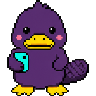

# Flash Audit rounds, 2026-10-17 (Idle Flash Audit)

Rounds 3 to 83, one card per pet program, in the [Flash Audit](https://github.com/findastra/astras-pet-os/blob/main/docs/flash-audit-20261014.md) owner-round format: pictures, then exceptions (most important first), then decisions. Rounds 1 (Farmer) and 2 (Goldfish) were done with Codex on 2026-10-14. How this run works: [Idle Flash Audit](../idle-flash-audit-20261017.md).

**On the iPad:** answer on the [Flash Audit Answers](https://claude.ai/artifact/W6FMZthEzhj9EWxBgggCyc) page (open it in Claude; every tap saves, and the next assistant reads the answers there), or tap a round below and answer in chat in any shape, for example `31 A`, `59 wait`, `merge all`. Nothing changes until you answer.

## Answer these first

- **Merge the fix PRs.** 78 pull requests hold only fixes that need no decision. Tap through them below, or say **merge all** and Claude merges each one whose checks pass.
- **Spoonfed is public.** The registry and its provenance file say it is a private, artwork-only repo. [Round 20](round-20-spoonfed.md).
- **Codex's shared page framework.** Clicker Training, the yellow phone, paper and zoom, and the L3 bubble (A41, A44, A45, A52) are built on Codex branches (`codex/l3-activity-20261016` and others) with no pull requests. Merging them clears four checks on most pets. See each round's Branches decision.
- **Four old hub PRs.** [#5](https://github.com/findastra/astras-pet-os/pull/5) is an old draft card 008 for five placeholder pets that are already pipeline pets (tonight's fix PRs replace the eight README lines that pointed at it); [#4](https://github.com/findastra/astras-pet-os/pull/4) (Backup Beaver candidate) and [#3](https://github.com/findastra/astras-pet-os/pull/3) (Meme Fiend in the Cage) are pipeline pets now; [#1](https://github.com/findastra/astras-pet-os/pull/1) is about the retired Cage. Close them?
- **Two new repos are private.** `pet-program-81` (Intel Owl) and `the-threshold` (Door Dormouse) were started tonight as private repos; the other 41 seed and roadmap repos are public. Make them public?
- **Folder rename.** Renaming `Documents\Astra's Pet Apps` to `Astra's PetOS` was tried at 04:16 and Windows said the folder was in use (most likely the Claude app's open chats), so nothing changed. Close the Claude app and Codex, then run `rename-petos-folder-20261017.ps1 -Apply` from File Master's plan folder (`file-master\reports\2026-10-17_rename-astras-petos`), or ask an assistant to.
- **Pending pet submissions.** The Astral Plane, Mail Snail, Raspberry Pi Berry and Voicemeeter Bug each submitted a job that differs from the registry. Their rounds show both.

## Every round

| Round | Pet | Program | Stage | Open | Fixed in PR | Decisions | Fix PR |
|--:|---|---|---|--:|--:|--:|---|
| [3](round-03-data-dealer.md) |  [Chip](round-03-data-dealer.md) | Data Dealer | registered | 10 | 4 | 2 | [data-dealer#2](https://github.com/findastra/data-dealer/pull/2) |
| [4](round-04-api-fairy.md) |  [API Fairy](round-04-api-fairy.md) | API Fairy Ring | registered | 7 | 3 | 0 | [api-fairy#1](https://github.com/findastra/api-fairy/pull/1) |
| [5](round-05-unity-unicorn.md) |  [Unity Unicorn](round-05-unity-unicorn.md) | Unity Stable | registered | 9 | 4 | 1 | [unity-unicorn#4](https://github.com/findastra/unity-unicorn/pull/4) |
| [6](round-06-learn-python.md) |  [Python Panther](round-06-learn-python.md) | Python Jungle | registered | 10 | 5 | 0 | [learn-python#3](https://github.com/findastra/learn-python/pull/3) |
| [7](round-07-the-astral-plane.md) |  [Astra Wisp](round-07-the-astral-plane.md) | The Astral Plane | registered | 14 | 3 | 2 | [the-astral-plane#3](https://github.com/findastra/the-astral-plane/pull/3) |
| [8](round-08-health-hummy.md) |  [Health Hummy](round-08-health-hummy.md) | The Nectar Nest | registered | 7 | 4 | 0 | [health-hummy#2](https://github.com/findastra/health-hummy/pull/2) |
| [9](round-09-finance-finch.md) |  [Finance Finch](round-09-finance-finch.md) | Nest Egg | registered | 7 | 4 | 0 | [finance-finch#2](https://github.com/findastra/finance-finch/pull/2) |
| [10](round-10-mommys-mommies.md) |  [Mommy's Mommies](round-10-mommys-mommies.md) | Mommy’s Green Room | registered | 11 | 4 | 0 | [mommys-mommies#2](https://github.com/findastra/mommys-mommies/pull/2) |
| [11](round-11-paper-girl.md) |  [Patty](round-11-paper-girl.md) | Paper Girl | registered | 9 | 6 | 0 | [paper-girl#1](https://github.com/findastra/paper-girl/pull/1) |
| [12](round-12-file-master.md) |  [File Master](round-12-file-master.md) | File Kingdom | registered | 9 | 4 | 1 | [file-master#5](https://github.com/findastra/file-master/pull/5) |
| [13](round-13-findastra-discord-presence.md) |  [Discord Damsel](round-13-findastra-discord-presence.md) | Discord Tower | registered | 11 | 5 | 1 | [findastra-discord-presence#3](https://github.com/findastra/findastra-discord-presence/pull/3) |
| [14](round-14-portfolio-puffer.md) |  [Portfolio Puffer](round-14-portfolio-puffer.md) | Iced Out Iceberg | registered | 7 | 4 | 0 | [portfolio-puffer#2](https://github.com/findastra/portfolio-puffer/pull/2) |
| [15](round-15-drum-dog.md) |  [Drum Dog](round-15-drum-dog.md) | Bass & Biscuits | registered | 8 | 4 | 0 | [drum-dog#2](https://github.com/findastra/drum-dog/pull/2) |
| [16](round-16-vscode-angel.md) |  [VSCode Angel](round-16-vscode-angel.md) | Halo List | registered | 9 | 4 | 1 | [vscode-angel#2](https://github.com/findastra/vscode-angel/pull/2) |
| [17](round-17-ghost-protocol.md) |  [Gone Ghost](round-17-ghost-protocol.md) | Am I a Ghost? | registered | 9 | 5 | 0 | [ghost-protocol#4](https://github.com/findastra/ghost-protocol/pull/4) |
| [18](round-18-project-parrot.md) |  [Project Parrot](round-18-project-parrot.md) | Idea Perch | registered | 8 | 3 | 0 | [project-parrot#2](https://github.com/findastra/project-parrot/pull/2) |
| [19](round-19-voicemeeter-bug.md) |  [Voicemeeter Bug](round-19-voicemeeter-bug.md) | Audio Rescue | registered | 9 | 2 | 1 | [voicemeeter-bug#1](https://github.com/findastra/voicemeeter-bug/pull/1) |
| [20](round-20-spoonfed.md) |  [Sugarcube](round-20-spoonfed.md) | Spoonfed | pipeline | 6 | 2 | 2 | [spoonfed#1](https://github.com/findastra/spoonfed/pull/1) |
| [21](round-21-claude-bot.md) |  [Claude Bot](round-21-claude-bot.md) | Claude Dock | pipeline | 7 | 4 | 0 | [claude-bot#1](https://github.com/findastra/claude-bot/pull/1) |
| [22](round-22-rgbee.md) |  [RGBee](round-22-rgbee.md) | Light Hive | pipeline | 8 | 3 | 0 | [rgbee#2](https://github.com/findastra/rgbee/pull/2) |
| [23](round-23-mine-mole.md) |  [Mine Mole](round-23-mine-mole.md) | Crypto Burrow | pipeline | 10 | 6 | 1 | [mine-mole#2](https://github.com/findastra/mine-mole/pull/2) |
| [24](round-24-mail-snail.md) |  [Mail Snail](round-24-mail-snail.md) | Mail Shell | pipeline | 9 | 3 | 2 | [mail-snail#2](https://github.com/findastra/mail-snail/pull/2) |
| [25](round-25-patch-cat.md) |  [Patch Cat](round-25-patch-cat.md) | The Litter Box | pipeline | 8 | 3 | 1 | [patch-cat#2](https://github.com/findastra/patch-cat/pull/2) |
| [26](round-26-meme-fiend.md) |  [Meme Fiend](round-26-meme-fiend.md) | Cursed Archive | pipeline | 7 | 4 | 0 | [meme-fiend#2](https://github.com/findastra/meme-fiend/pull/2) |
| [27](round-27-astras-gif-maker.md) |  [Gif Giraffe](round-27-astras-gif-maker.md) | Astra's GIF Maker | pipeline | 8 | 2 | 0 | [astras-gif-maker#1](https://github.com/findastra/astras-gif-maker/pull/1) |
| [28](round-28-backup-beaver.md) |  [Backup Beaver](round-28-backup-beaver.md) | Backup Dam | pipeline | 7 | 4 | 0 | [backup-beaver#2](https://github.com/findastra/backup-beaver/pull/2) |
| [29](round-29-rift-rabbit.md) |  [Rift Rabbit](round-29-rift-rabbit.md) | Wonderland Launchpad | pipeline | 9 | 3 | 1 | [rift-rabbit#2](https://github.com/findastra/rift-rabbit/pull/2) |
| [30](round-30-fuzzboi-friend.md) |  [Fuzzboi Friend](round-30-fuzzboi-friend.md) | Fuzzboi Factory | pipeline | 8 | 4 | 0 | [fuzzboi-friend#2](https://github.com/findastra/fuzzboi-friend/pull/2) |
| [31](round-31-wifi-butterfly.md) |  [Wifi Butterfly](round-31-wifi-butterfly.md) | pet-program-31 | pipeline | 7 | 3 | 1 | [wifi-butterfly#2](https://github.com/findastra/wifi-butterfly/pull/2) |
| [32](round-32-deck-duck.md) |  [Deck Duck](round-32-deck-duck.md) | pet-program-32 | pipeline | 10 | 4 | 2 | [deck-duck#2](https://github.com/findastra/deck-duck/pull/2) |
| [33](round-33-mesh-moth.md) |  [Mesh Moth](round-33-mesh-moth.md) | pet-program-33 | pipeline | 9 | 4 | 1 | [mesh-moth#2](https://github.com/findastra/mesh-moth/pull/2) |
| [34](round-34-raspberry-berry.md) |  [Raspberry Pi Berry](round-34-raspberry-berry.md) | Raspberry Pi Maker | pipeline | 11 | 2 | 1 | [raspberry-berry#3](https://github.com/findastra/raspberry-berry/pull/3) |
| [35](round-35-chat-rat.md) |  [Chat Rat](round-35-chat-rat.md) | Chat Stack | pipeline | 10 | 3 | 1 | [chat-rat#5](https://github.com/findastra/chat-rat/pull/5) |
| [36](round-36-platform-platypus.md) |  [Platform Platypus](round-36-platform-platypus.md) | Mirror Pool | registered | 8 | 0 | 0 | — |
| [37](round-37-pet-program-37.md) | [Dubstep Gunsmith](round-37-pet-program-37.md) | Dubstep Armory | seed | 2 | 2 | 0 | [pet-program-37#1](https://github.com/findastra/pet-program-37/pull/1) |
| [38](round-38-pet-program-38.md) |  [Pole Puff](round-38-pet-program-38.md) | Infinite Studio | seed | 3 | 2 | 0 | [pet-program-38#1](https://github.com/findastra/pet-program-38/pull/1) |
| [39](round-39-pet-program-39.md) |  [Procreate Panda](round-39-pet-program-39.md) | pet-program-39 | seed | 4 | 2 | 1 | [pet-program-39#1](https://github.com/findastra/pet-program-39/pull/1) |
| [40](round-40-pet-program-40.md) |  [Skill Scout](round-40-pet-program-40.md) | pet-program-40 | seed | 5 | 2 | 1 | [pet-program-40#1](https://github.com/findastra/pet-program-40/pull/1) |
| [41](round-41-pet-program-41.md) |  [OSC Sealion](round-41-pet-program-41.md) | pet-program-41 | seed | 4 | 2 | 1 | [pet-program-41#1](https://github.com/findastra/pet-program-41/pull/1) |
| [42](round-42-pet-program-42.md) |  [Piranesi Nessi](round-42-pet-program-42.md) | Nessi's Ocean | seed | 3 | 2 | 0 | [pet-program-42#1](https://github.com/findastra/pet-program-42/pull/1) |
| [43](round-43-pet-program-43.md) |  [Photo Dodo](round-43-pet-program-43.md) | pet-program-43 | seed | 4 | 2 | 1 | [pet-program-43#1](https://github.com/findastra/pet-program-43/pull/1) |
| [44](round-44-pet-program-44.md) |  [Video Vulture](round-44-pet-program-44.md) | pet-program-44 | seed | 4 | 2 | 1 | [pet-program-44#1](https://github.com/findastra/pet-program-44/pull/1) |
| [45](round-45-the-cats-closet.md) |  [Closet Cat](round-45-the-cats-closet.md) | pet-program-45 | seed | 4 | 2 | 1 | [the-cats-closet#1](https://github.com/findastra/the-cats-closet/pull/1) |
| [46](round-46-iron-gates.md) | [Gatekeeper Goddess](round-46-iron-gates.md) | Iron Gates | roadmap | 2 | 2 | 0 | [iron-gates#1](https://github.com/findastra/iron-gates/pull/1) |
| [47](round-47-pet-program-47.md) | [Queue Quokka](round-47-pet-program-47.md) | pet-program-47 | roadmap | 3 | 2 | 1 | [pet-program-47#1](https://github.com/findastra/pet-program-47/pull/1) |
| [48](round-48-pet-program-48.md) | [Log Lynx](round-48-pet-program-48.md) | pet-program-48 | roadmap | 3 | 2 | 1 | [pet-program-48#1](https://github.com/findastra/pet-program-48/pull/1) |
| [49](round-49-pet-program-49.md) | [Server Salamander](round-49-pet-program-49.md) | pet-program-49 | roadmap | 3 | 2 | 1 | [pet-program-49#1](https://github.com/findastra/pet-program-49/pull/1) |
| [50](round-50-pet-program-50.md) | [Docker Dragon](round-50-pet-program-50.md) | pet-program-50 | roadmap | 3 | 2 | 1 | [pet-program-50#1](https://github.com/findastra/pet-program-50/pull/1) |
| [51](round-51-pet-program-51.md) | [Test Tortoise](round-51-pet-program-51.md) | pet-program-51 | roadmap | 3 | 2 | 1 | [pet-program-51#1](https://github.com/findastra/pet-program-51/pull/1) |
| [52](round-52-pet-program-52.md) | [Token Toucan](round-52-pet-program-52.md) | pet-program-52 | roadmap | 3 | 2 | 1 | [pet-program-52#1](https://github.com/findastra/pet-program-52/pull/1) |
| [53](round-53-pet-program-53.md) | [Packet Piranha](round-53-pet-program-53.md) | pet-program-53 | roadmap | 3 | 2 | 1 | [pet-program-53#1](https://github.com/findastra/pet-program-53/pull/1) |
| [54](round-54-pet-program-54.md) | [Calendar Crow](round-54-pet-program-54.md) | pet-program-54 | roadmap | 3 | 2 | 1 | [pet-program-54#1](https://github.com/findastra/pet-program-54/pull/1) |
| [55](round-55-pet-program-55.md) | [Browser Bat](round-55-pet-program-55.md) | pet-program-55 | roadmap | 3 | 2 | 1 | [pet-program-55#1](https://github.com/findastra/pet-program-55/pull/1) |
| [56](round-56-pet-program-56.md) | [Data Dragonfly](round-56-pet-program-56.md) | pet-program-56 | roadmap | 3 | 2 | 1 | [pet-program-56#1](https://github.com/findastra/pet-program-56/pull/1) |
| [57](round-57-pet-program-57.md) | [Update Urchin](round-57-pet-program-57.md) | pet-program-57 | roadmap | 3 | 2 | 1 | [pet-program-57#1](https://github.com/findastra/pet-program-57/pull/1) |
| [58](round-58-pet-program-58.md) | [Linux Penguin](round-58-pet-program-58.md) | pet-program-58 | roadmap | 3 | 2 | 1 | [pet-program-58#1](https://github.com/findastra/pet-program-58/pull/1) |
| [59](round-59-pet-program-59.md) | [Stock Fox](round-59-pet-program-59.md) | pet-program-59 | roadmap | 3 | 2 | 1 | [pet-program-59#1](https://github.com/findastra/pet-program-59/pull/1) |
| [60](round-60-pet-program-60.md) | [Passport Pelican](round-60-pet-program-60.md) | pet-program-60 | roadmap | 3 | 2 | 1 | [pet-program-60#1](https://github.com/findastra/pet-program-60/pull/1) |
| [61](round-61-pet-program-61.md) | [Journal Jellyfish](round-61-pet-program-61.md) | pet-program-61 | roadmap | 3 | 2 | 1 | [pet-program-61#1](https://github.com/findastra/pet-program-61/pull/1) |
| [62](round-62-pet-program-62.md) | [Shell Squid](round-62-pet-program-62.md) | pet-program-62 | roadmap | 3 | 2 | 1 | [pet-program-62#1](https://github.com/findastra/pet-program-62/pull/1) |
| [63](round-63-pet-program-63.md) | [Kernel Koala](round-63-pet-program-63.md) | pet-program-63 | roadmap | 3 | 2 | 1 | [pet-program-63#1](https://github.com/findastra/pet-program-63/pull/1) |
| [64](round-64-pet-program-64.md) | [Proxy Axolotl](round-64-pet-program-64.md) | pet-program-64 | roadmap | 3 | 2 | 1 | [pet-program-64#1](https://github.com/findastra/pet-program-64/pull/1) |
| [65](round-65-pet-program-65.md) | [Cluster Crab](round-65-pet-program-65.md) | pet-program-65 | roadmap | 3 | 2 | 1 | [pet-program-65#1](https://github.com/findastra/pet-program-65/pull/1) |
| [66](round-66-pet-program-66.md) | [Storage Stoat](round-66-pet-program-66.md) | pet-program-66 | roadmap | 3 | 2 | 1 | [pet-program-66#1](https://github.com/findastra/pet-program-66/pull/1) |
| [67](round-67-pet-program-67.md) | [White Hat Weasel](round-67-pet-program-67.md) | pet-program-67 | roadmap | 3 | 2 | 1 | [pet-program-67#1](https://github.com/findastra/pet-program-67/pull/1) |
| [68](round-68-pet-program-68.md) | [Port Spider](round-68-pet-program-68.md) | pet-program-68 | roadmap | 3 | 2 | 1 | [pet-program-68#1](https://github.com/findastra/pet-program-68/pull/1) |
| [69](round-69-pet-program-69.md) | [Cipher Owl](round-69-pet-program-69.md) | pet-program-69 | roadmap | 3 | 2 | 1 | [pet-program-69#1](https://github.com/findastra/pet-program-69/pull/1) |
| [70](round-70-pet-program-70.md) | [Forensic Ferret](round-70-pet-program-70.md) | pet-program-70 | roadmap | 3 | 2 | 1 | [pet-program-70#1](https://github.com/findastra/pet-program-70/pull/1) |
| [71](round-71-pet-program-71.md) | [Llama Librarian](round-71-pet-program-71.md) | pet-program-71 | roadmap | 3 | 2 | 1 | [pet-program-71#1](https://github.com/findastra/pet-program-71/pull/1) |
| [72](round-72-pet-program-72.md) | [Inference Iguana](round-72-pet-program-72.md) | pet-program-72 | roadmap | 3 | 2 | 1 | [pet-program-72#1](https://github.com/findastra/pet-program-72/pull/1) |
| [73](round-73-pet-program-73.md) | [Agent Ant](round-73-pet-program-73.md) | pet-program-73 | roadmap | 3 | 2 | 1 | [pet-program-73#1](https://github.com/findastra/pet-program-73/pull/1) |
| [74](round-74-pet-program-74.md) | [Roaming Raven](round-74-pet-program-74.md) | pet-program-74 | roadmap | 3 | 2 | 1 | [pet-program-74#1](https://github.com/findastra/pet-program-74/pull/1) |
| [75](round-75-pet-program-75.md) | [Cache Coyote](round-75-pet-program-75.md) | pet-program-75 | roadmap | 3 | 2 | 1 | [pet-program-75#1](https://github.com/findastra/pet-program-75/pull/1) |
| [76](round-76-pet-program-76.md) | [Sync Mink](round-76-pet-program-76.md) | pet-program-76 | roadmap | 3 | 2 | 1 | [pet-program-76#1](https://github.com/findastra/pet-program-76/pull/1) |
| [77](round-77-pet-program-77.md) | [pet-program-77-icon-77](round-77-pet-program-77.md) | pet-program-77 | seed | 4 | 2 | 2 | [pet-program-77#1](https://github.com/findastra/pet-program-77/pull/1) |
| [78](round-78-the-police-station.md) | [Pet Police Officer](round-78-the-police-station.md) | The Police Station | seed | 3 | 2 | 0 | [the-police-station#1](https://github.com/findastra/the-police-station/pull/1) |
| [79](round-79-ai-doghouse.md) | [AI Dashund](round-79-ai-doghouse.md) | AI Doghouse | seed | 2 | 2 | 0 | [ai-doghouse#1](https://github.com/findastra/ai-doghouse/pull/1) |
| [80](round-80-the-recovery-room.md) | [Rescue Retriever](round-80-the-recovery-room.md) | The Recovery Room | seed | 3 | 2 | 0 | [the-recovery-room#1](https://github.com/findastra/the-recovery-room/pull/1) |
| [81](round-81-pet-program-81.md) | [Intel Owl](round-81-pet-program-81.md) | pet-program-81 | seed | 4 | 0 | 2 | — |
| [82](round-82-the-threshold.md) | [Door Dormouse](round-82-the-threshold.md) | The Threshold | seed | 3 | 0 | 1 | — |
| [83](round-83-role-fairy.md) | [Role Fairy](round-83-role-fairy.md) | Fairy Ring | pipeline | 9 | 4 | 1 | [role-fairy#1](https://github.com/findastra/role-fairy/pull/1) |

## All fix PRs in one list

- [data-dealer#2](https://github.com/findastra/data-dealer/pull/2) — Round 3, Chip
- [api-fairy#1](https://github.com/findastra/api-fairy/pull/1) — Round 4, API Fairy
- [unity-unicorn#4](https://github.com/findastra/unity-unicorn/pull/4) — Round 5, Unity Unicorn
- [learn-python#3](https://github.com/findastra/learn-python/pull/3) — Round 6, Python Panther
- [the-astral-plane#3](https://github.com/findastra/the-astral-plane/pull/3) — Round 7, Astra Wisp
- [health-hummy#2](https://github.com/findastra/health-hummy/pull/2) — Round 8, Health Hummy
- [finance-finch#2](https://github.com/findastra/finance-finch/pull/2) — Round 9, Finance Finch
- [mommys-mommies#2](https://github.com/findastra/mommys-mommies/pull/2) — Round 10, Mommy's Mommies
- [paper-girl#1](https://github.com/findastra/paper-girl/pull/1) — Round 11, Patty
- [file-master#5](https://github.com/findastra/file-master/pull/5) — Round 12, File Master
- [findastra-discord-presence#3](https://github.com/findastra/findastra-discord-presence/pull/3) — Round 13, Discord Damsel
- [portfolio-puffer#2](https://github.com/findastra/portfolio-puffer/pull/2) — Round 14, Portfolio Puffer
- [drum-dog#2](https://github.com/findastra/drum-dog/pull/2) — Round 15, Drum Dog
- [vscode-angel#2](https://github.com/findastra/vscode-angel/pull/2) — Round 16, VSCode Angel
- [ghost-protocol#4](https://github.com/findastra/ghost-protocol/pull/4) — Round 17, Gone Ghost
- [project-parrot#2](https://github.com/findastra/project-parrot/pull/2) — Round 18, Project Parrot
- [voicemeeter-bug#1](https://github.com/findastra/voicemeeter-bug/pull/1) — Round 19, Voicemeeter Bug
- [spoonfed#1](https://github.com/findastra/spoonfed/pull/1) — Round 20, Sugarcube
- [claude-bot#1](https://github.com/findastra/claude-bot/pull/1) — Round 21, Claude Bot
- [rgbee#2](https://github.com/findastra/rgbee/pull/2) — Round 22, RGBee
- [mine-mole#2](https://github.com/findastra/mine-mole/pull/2) — Round 23, Mine Mole
- [mail-snail#2](https://github.com/findastra/mail-snail/pull/2) — Round 24, Mail Snail
- [patch-cat#2](https://github.com/findastra/patch-cat/pull/2) — Round 25, Patch Cat
- [meme-fiend#2](https://github.com/findastra/meme-fiend/pull/2) — Round 26, Meme Fiend
- [astras-gif-maker#1](https://github.com/findastra/astras-gif-maker/pull/1) — Round 27, Gif Giraffe
- [backup-beaver#2](https://github.com/findastra/backup-beaver/pull/2) — Round 28, Backup Beaver
- [rift-rabbit#2](https://github.com/findastra/rift-rabbit/pull/2) — Round 29, Rift Rabbit
- [fuzzboi-friend#2](https://github.com/findastra/fuzzboi-friend/pull/2) — Round 30, Fuzzboi Friend
- [wifi-butterfly#2](https://github.com/findastra/wifi-butterfly/pull/2) — Round 31, Wifi Butterfly
- [deck-duck#2](https://github.com/findastra/deck-duck/pull/2) — Round 32, Deck Duck
- [mesh-moth#2](https://github.com/findastra/mesh-moth/pull/2) — Round 33, Mesh Moth
- [raspberry-berry#3](https://github.com/findastra/raspberry-berry/pull/3) — Round 34, Raspberry Pi Berry
- [chat-rat#5](https://github.com/findastra/chat-rat/pull/5) — Round 35, Chat Rat
- [pet-program-37#1](https://github.com/findastra/pet-program-37/pull/1) — Round 37, Dubstep Gunsmith
- [pet-program-38#1](https://github.com/findastra/pet-program-38/pull/1) — Round 38, Pole Puff
- [pet-program-39#1](https://github.com/findastra/pet-program-39/pull/1) — Round 39, Procreate Panda
- [pet-program-40#1](https://github.com/findastra/pet-program-40/pull/1) — Round 40, Skill Scout
- [pet-program-41#1](https://github.com/findastra/pet-program-41/pull/1) — Round 41, OSC Sealion
- [pet-program-42#1](https://github.com/findastra/pet-program-42/pull/1) — Round 42, Piranesi Nessi
- [pet-program-43#1](https://github.com/findastra/pet-program-43/pull/1) — Round 43, Photo Dodo
- [pet-program-44#1](https://github.com/findastra/pet-program-44/pull/1) — Round 44, Video Vulture
- [the-cats-closet#1](https://github.com/findastra/the-cats-closet/pull/1) — Round 45, Closet Cat
- [iron-gates#1](https://github.com/findastra/iron-gates/pull/1) — Round 46, Gatekeeper Goddess
- [pet-program-47#1](https://github.com/findastra/pet-program-47/pull/1) — Round 47, Queue Quokka
- [pet-program-48#1](https://github.com/findastra/pet-program-48/pull/1) — Round 48, Log Lynx
- [pet-program-49#1](https://github.com/findastra/pet-program-49/pull/1) — Round 49, Server Salamander
- [pet-program-50#1](https://github.com/findastra/pet-program-50/pull/1) — Round 50, Docker Dragon
- [pet-program-51#1](https://github.com/findastra/pet-program-51/pull/1) — Round 51, Test Tortoise
- [pet-program-52#1](https://github.com/findastra/pet-program-52/pull/1) — Round 52, Token Toucan
- [pet-program-53#1](https://github.com/findastra/pet-program-53/pull/1) — Round 53, Packet Piranha
- [pet-program-54#1](https://github.com/findastra/pet-program-54/pull/1) — Round 54, Calendar Crow
- [pet-program-55#1](https://github.com/findastra/pet-program-55/pull/1) — Round 55, Browser Bat
- [pet-program-56#1](https://github.com/findastra/pet-program-56/pull/1) — Round 56, Data Dragonfly
- [pet-program-57#1](https://github.com/findastra/pet-program-57/pull/1) — Round 57, Update Urchin
- [pet-program-58#1](https://github.com/findastra/pet-program-58/pull/1) — Round 58, Linux Penguin
- [pet-program-59#1](https://github.com/findastra/pet-program-59/pull/1) — Round 59, Stock Fox
- [pet-program-60#1](https://github.com/findastra/pet-program-60/pull/1) — Round 60, Passport Pelican
- [pet-program-61#1](https://github.com/findastra/pet-program-61/pull/1) — Round 61, Journal Jellyfish
- [pet-program-62#1](https://github.com/findastra/pet-program-62/pull/1) — Round 62, Shell Squid
- [pet-program-63#1](https://github.com/findastra/pet-program-63/pull/1) — Round 63, Kernel Koala
- [pet-program-64#1](https://github.com/findastra/pet-program-64/pull/1) — Round 64, Proxy Axolotl
- [pet-program-65#1](https://github.com/findastra/pet-program-65/pull/1) — Round 65, Cluster Crab
- [pet-program-66#1](https://github.com/findastra/pet-program-66/pull/1) — Round 66, Storage Stoat
- [pet-program-67#1](https://github.com/findastra/pet-program-67/pull/1) — Round 67, White Hat Weasel
- [pet-program-68#1](https://github.com/findastra/pet-program-68/pull/1) — Round 68, Port Spider
- [pet-program-69#1](https://github.com/findastra/pet-program-69/pull/1) — Round 69, Cipher Owl
- [pet-program-70#1](https://github.com/findastra/pet-program-70/pull/1) — Round 70, Forensic Ferret
- [pet-program-71#1](https://github.com/findastra/pet-program-71/pull/1) — Round 71, Llama Librarian
- [pet-program-72#1](https://github.com/findastra/pet-program-72/pull/1) — Round 72, Inference Iguana
- [pet-program-73#1](https://github.com/findastra/pet-program-73/pull/1) — Round 73, Agent Ant
- [pet-program-74#1](https://github.com/findastra/pet-program-74/pull/1) — Round 74, Roaming Raven
- [pet-program-75#1](https://github.com/findastra/pet-program-75/pull/1) — Round 75, Cache Coyote
- [pet-program-76#1](https://github.com/findastra/pet-program-76/pull/1) — Round 76, Sync Mink
- [pet-program-77#1](https://github.com/findastra/pet-program-77/pull/1) — Round 77, pet-program-77-icon-77
- [the-police-station#1](https://github.com/findastra/the-police-station/pull/1) — Round 78, Pet Police Officer
- [ai-doghouse#1](https://github.com/findastra/ai-doghouse/pull/1) — Round 79, AI Dashund
- [the-recovery-room#1](https://github.com/findastra/the-recovery-room/pull/1) — Round 80, Rescue Retriever
- [role-fairy#1](https://github.com/findastra/role-fairy/pull/1) — Round 83, Role Fairy

Idle Flash Audit, 2026-10-17, Claude Opus 5.5 (`claude-opus-5-5`). Built by `scripts/idle-flash-cards-20261017.mjs` from the evidence ledger in this folder.
