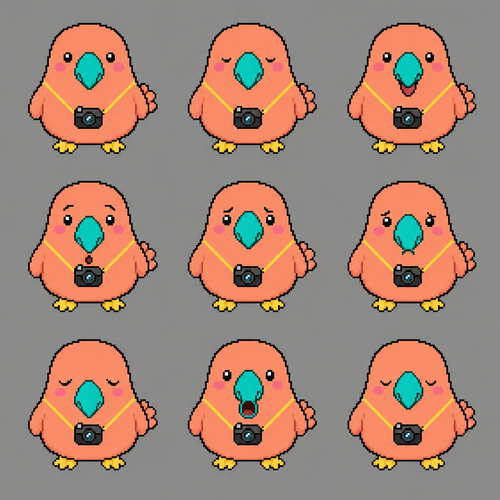

# Round 43: Photo Dodo — pet-program-43

[All rounds](README.md) · Stage: **seed** · Repo: [findastra/pet-program-43](https://github.com/findastra/pet-program-43) (public) · audited `main` at `dfd601a`

 *Draft seed sheet (not approved art; no frames in the hub yet).*

**Fix PR waiting for you:** [pet-program-43#1](https://github.com/findastra/pet-program-43/pull/1)

### Exceptions

1. **A07 Program name** — Missing. Program name not chosen (suggested idea: Photo Roost).  
   *Next:* Your pick: see Decisions.
2. **A01 Icon** — Missing. No icon in astras-pet-os art/icons.  
   *Next:* Needs pet art. Generating art costs money, so it waits for your OK.
3. **A13 Repo** — Incorrect. Catalog says repo_exists false, but pet-program-43 is on GitHub.  
   *Next:* The hub PR for tonight fixes the catalog.
4. **Not built yet (planned):** A09 Program page, A16 pet.json, A55 Pictures, A18 Tool list, A52 L3 activity bubble, A44 Yellow phone, A45 Paper and zoom, A41 Clicker Training. Normal for a seed; not a failure.

### Fixed tonight (in the fix PR, waiting for your merge)

- **A14 Required files** — Required files: CLAUDE.md
- **A15 README and credit** — README lacks the credit line "*A pet app by Astra.*". README has no Limits section.

What the fix PR changes, exactly

- Added CLAUDE.md (pointer to AGENTS.md and the hub rules).
- README: "Status" became the "Run it" and "Limits" sections the pet file rules ask for.
- README: records who made it and when (copied from AGENTS.md).
- README: added the credit line "*A pet app by Astra.*".

### Decisions

1. **Program name** for Photo Dodo (now `pet-program-43`). Pick one, or write your own:
   - **A. Photo Roost** — the catalog idea: where pictures roost
   - **B. Picture Nest** — every saved picture, found and backed up
   - **C. The Photo Archive** — plain about the job
   - **D. Dodo Album** — a friendly album that never goes extinct
2. **Merge the fix PR** [pet-program-43#1](https://github.com/findastra/pet-program-43/pull/1)? It only holds fixes that need no decision (listed above).

**Tools:** none declared in pet.json yet (A18).  
**Tutorial tools:** Play with, Care for — Not verified overnight.

Idle Flash Audit, 2026-10-17, Claude Opus 5.5. Read-only checks through the GitHub API; nothing was clicked, launched or signed in to.
